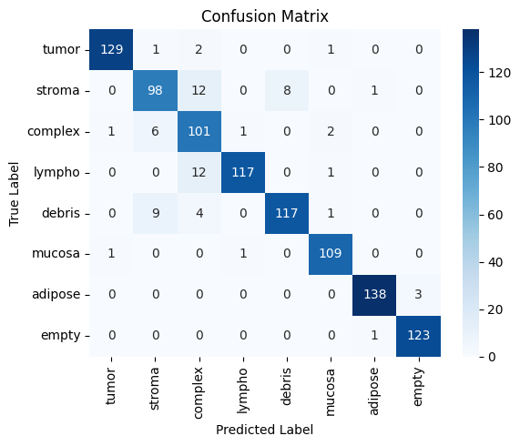
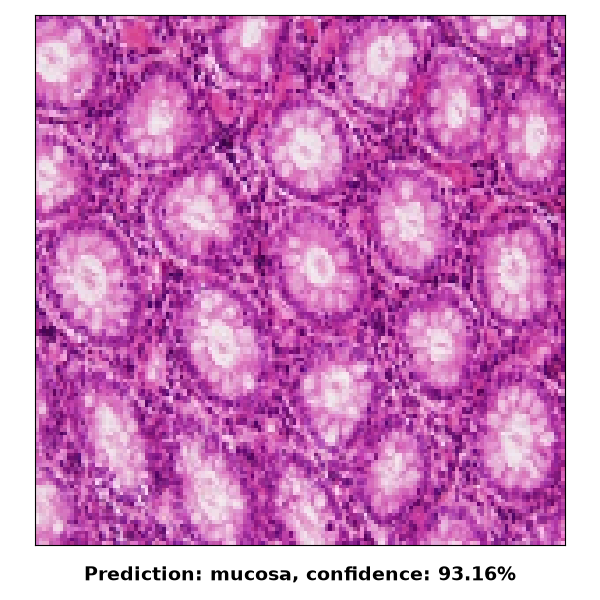

# Colorectal Histology Classification using CNN (ResNet50)

This repository contains a complete Deep Learning project for the automatic classification of histological images of colorectal cancer. It uses Transfer Learning techniques through the ResNet50 architecture to make accurate inferences on different tissue textures.

### Dataset description

The model was trained using the colorectal_histology dataset hosted in the TensorFlow Datasets (TFDS) catalog.   

- Size: 5000 RGB images.   
- Resolution: 150x150 pixels.   
- Categories (8): Tumor, stroma, complex, lympho, debris, mucosa, adipose, and empty.   

The data was split randomly (random_state=1) to ensure methodological reproducibility:   

- 70% Training (3500 images). 
- 12.5% Validation (500 images).   
- 20% Testing (1000 images).   

### Model Architecture and Training

The technical approach relies on Transfer Learning, loading the ResNet50 convolutional base pre-trained on ImageNet (with frozen weights).

- Preprocessing and Data Augmentation: ResNet50's preprocess_input was applied to the image arrays, and the training set was augmented using ImageDataGenerator (20-degree rotation, 10% width and height shift, and horizontal flip).   
- Classifier (Top layers): A GlobalAveragePooling2D layer was added, followed by a Dense layer of 128 neurons (ReLU activation, he_uniform kernel initializer), a 50% Dropout layer to prevent overfitting, and a final Dense layer of 8 neurons with Softmax activation.   
- Optimization: Adam optimizer with a learning rate of 0.001 and categorical_crossentropy loss function. EarlyStopping (patience = 5) was implemented to restore the best weights based on validation loss. 

### Results and Metrics

The model demonstrated outstanding performance when evaluated against the test set (1000 images previously unseen by the network):

- Accuracy: 93%   
- Precision: 94%   
- Recall: 93%   
- F1-Score: 93%

### Project Structure

CNN_modeltraining.ipynb: Jupyter Notebook documenting the entire model lifecycle: exploratory data analysis (EDA), preprocessing, building, training, and metrics evaluation.

image_prediction.py: Inference script that loads the .keras model and processes a user-input image, visually displaying the prediction and confidence percentage using Matplotlib with the Qt5Agg interface.

model/: Directory intended to store the trained model (resnet50_colorectal_histology.keras).

images/: Directory containing sample images ready to test the inference script.

### Installation and Usage

Clone the repository

Install dependencies:
It is recommended to create a virtual environment (.venv) and run:

pip install -r requirements.txt

Run a prediction:
Start the interactive inference script from the terminal:

python image_predictor.py

The program will prompt you for the number of the image to analyze (this file must be located in the images/ folder), and will return the prediction, for example:

